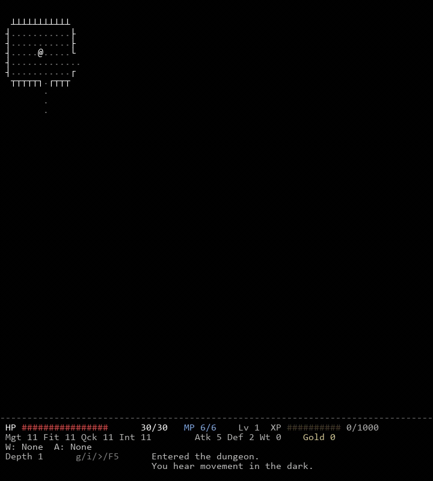
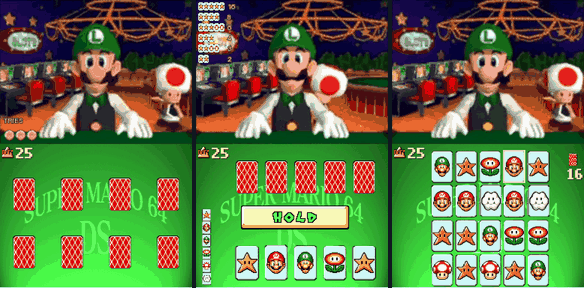
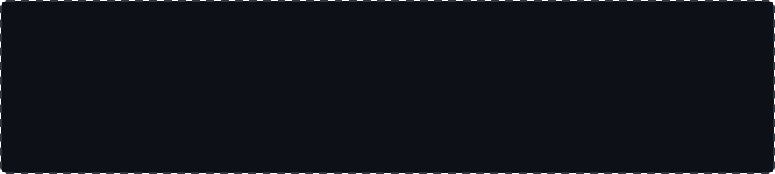

<h1 align="center">Drew Ramirez</h1>

Full-stack and systems developer

I build web applications, data-processing pipelines, systems software, and games. My current interests include AWS, C++ systems programming, graphics, procedural generation, and simulation.

  
  
  

<table width="100%">
  <tr>
    <td width="50%" valign="top">
      
    </td>
    <td width="50%" rowspan="2" valign="top">
      
    </td>
  </tr>
  <tr>
    <td width="50%" valign="top">
      
    </td>
  </tr>
  <tr>
    <td colspan="2" align="center">
      
    </td>
  </tr>
  <tr>
    <td colspan="2">
      <b>languages</b> 
      
      
      
      
      
      
    </td>
  </tr>
  <tr>
    <td colspan="2">
      <b>web / data</b> 
      
      
      
      
      
      
    </td>
  </tr>
  <tr>
    <td colspan="2">
      <b>systems / graphics</b> 
      
      
      
      
      
      
    </td>
  </tr>
  <tr>
    <td colspan="2">
      <b>infra / tooling</b> 
      
      
      
      
      
      
    </td>
  </tr>
</table>

  <a href="https://drewramirez.dev/projects"><strong>Explore my projects and engineering notes →</strong></a>

